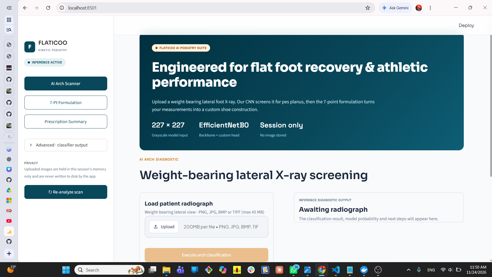
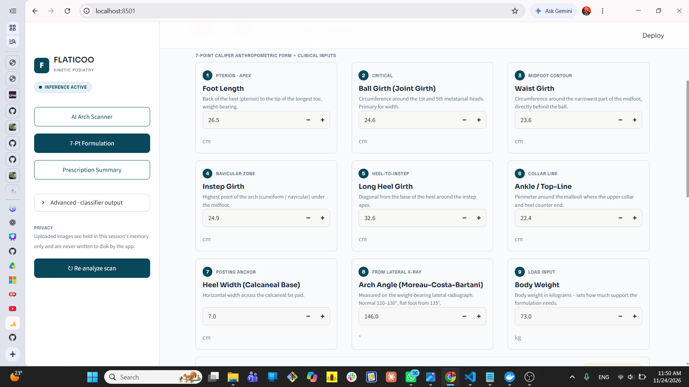

# Flaticoo 👣

Flaticoo is an AI-powered application designed to support flatfoot (Pes Planus) assessment and shoe material recommendation using Machine Learning and Deep Learning techniques.

## Project Overview

The application combines two machine learning models to provide two main functionalities:

### 1. Flatfoot Classification – EfficientNetB0

EfficientNetB0 is used to classify foot X-ray images into two categories:

- **Pes Planus:** Flatfoot.
- **Not Pes Planus:** Normal foot.

The model uses ImageNet-pretrained weights with a custom classification head for binary image classification.


### 2. Shoe Material Prediction – Ridge Regression

Ridge Regression is used to predict suitable shoe material based on engineered features from the shoe material dataset.

It uses L2 regularization to help reduce overfitting and improve prediction stability.


## Application Screenshots





## Run with Docker

Make sure you have [Docker Desktop](https://www.docker.com/products/docker-desktop/) installed and running.

**1. Clone the repository**

```bash
git clone YOUR_REPOSITORY_URL
cd Flaticoo
```

**2. Build the Docker image**

```bash
docker build -t flaticoo .
```

**3. Run the container**

```bash
docker run -d -p 8501:8501 --name flaticoo-container flaticoo
```

**4. Open the application**

Open your browser and visit:

```text
http://localhost:8501
```

**5. Stop the application**

```bash
docker stop flaticoo-container
```

To start it again:

```bash
docker start flaticoo-container
```

To remove the container:

```bash
docker rm -f flaticoo-container
```
